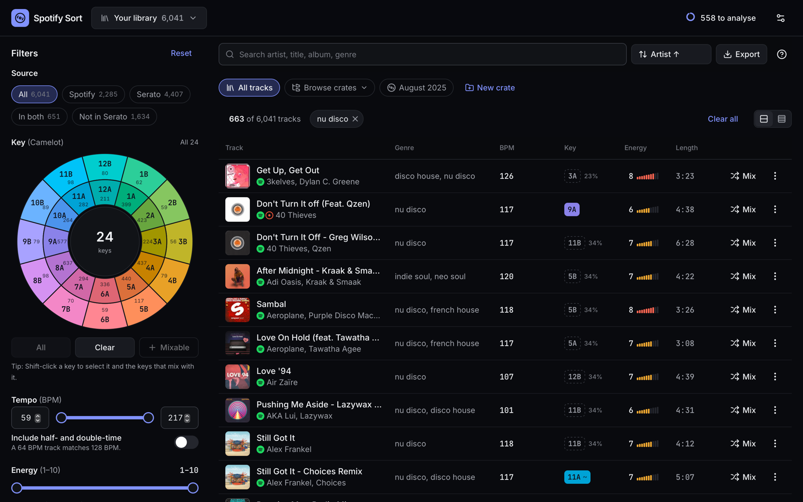
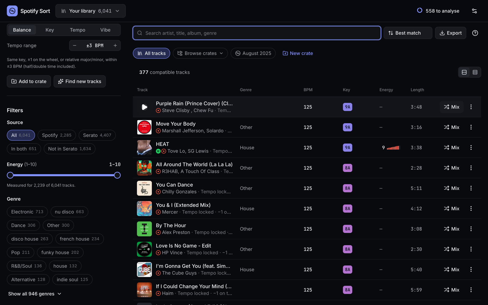
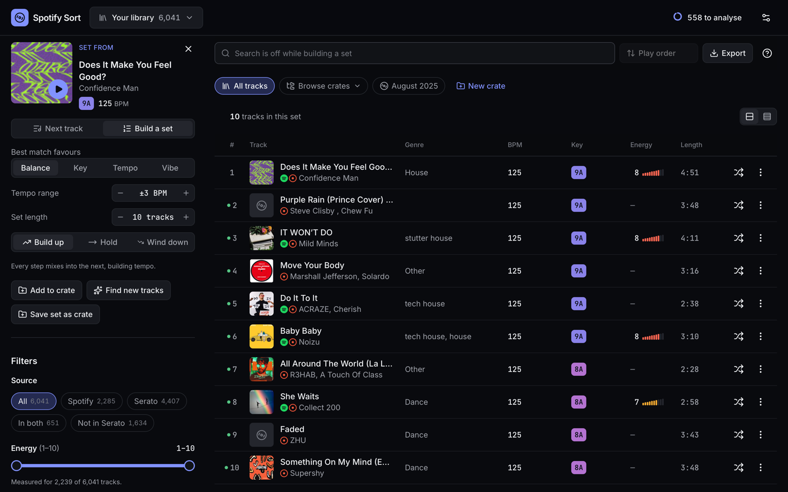
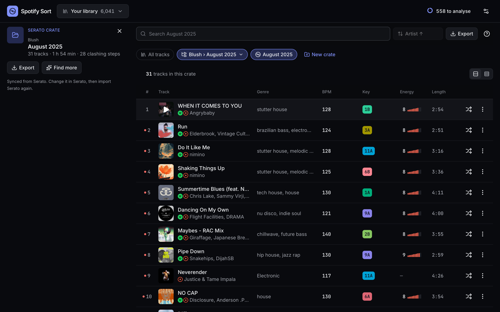
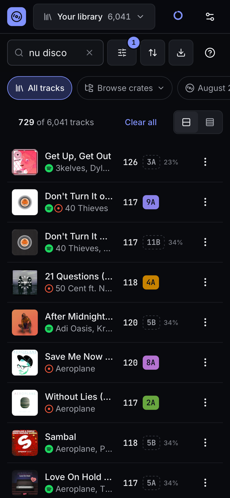

# Spotify Sort

A harmonic-mixing tool for building mixtapes that are beautiful and sonically seamless.
It brings a Spotify library and a whole Serato library together, measures tempo, key and
energy, and suggests what mixes next, without repeating songs from past mixtapes.

Runs as a **Mac app** (Tauri 2, native menus, reads Serato directly), as an installable web
app, or in a browser. Built for one DJ's workflow.



## What it does

- **One library from Spotify and Serato.** One click reads your whole Serato library and its
  crates. A song in both sources becomes one track. Source icons and filters show where each
  track lives.
- **Mix from any track.** Suggestions are ranked by tempo, Camelot key move, key confidence,
  genre and energy, and each row says why it fits. Chain suggestions into a set where every
  step mixes into the next, with rough or clashing transitions flagged.
- **Measures what Spotify no longer provides.** BPM, key (with an honest confidence %), energy
  and danceability are computed from your files or 30-second previews, alongside Serato-style
  3-band waveforms.
- **Crates and past mixtapes.** Drag tracks into your own crates, browse Serato's, and import
  old mixtape tracklists so used songs are flagged and suggested last.
- **Find new tracks**, like Spotify's playlist *Enhance*: it finds similar artists' tracks you
  don't own and keeps only those that mix.

<table>
  <tr>
    <td width="50%"><b>Mixing from a track</b><br></td>
    <td width="50%"><b>Building a set</b><br></td>
  </tr>
  <tr>
    <td><b>A Serato crate</b><br></td>
    <td align="center"><b>On a phone</b><br></td>
  </tr>
</table>

## Quick start

```sh
npm install
cp .env.example .env        # Spotify client ID (optional: links, Serato and files work without it)
npm run dev                 # http://127.0.0.1:5173
npm run desktop:build       # the Mac app → src-tauri/target/release/bundle/macos/
```

## Learn more

| | |
|---|---|
| [Setup and deploying](docs/setup.md) | Scripts, connecting Spotify, API limits, deploying the web build |
| [The Mac app](docs/mac-app.md) | What it adds, menus, keyboard shortcuts |
| [Importing](docs/importing.md) | Serato, Spotify and links, past mixtapes, DJ files, audio files, artwork, backups |
| [Mixing tools](docs/mixing.md) | Best match, sets, transitions, energy, Find new tracks, crates, filters, waveforms |
| [Audio analysis](docs/analysis.md) | Why and how tempo and key are measured, and how far to trust them |
| [Architecture](docs/architecture.md) | Code layout, key representation, design principles |
| [Roadmap](docs/roadmap.md) | Done and next |

Vue 3.5 · Reka UI · Tailwind 4 · Vite 8 · Pinia · Tauri 2 · Essentia.js · `node:test` (140 tests)
